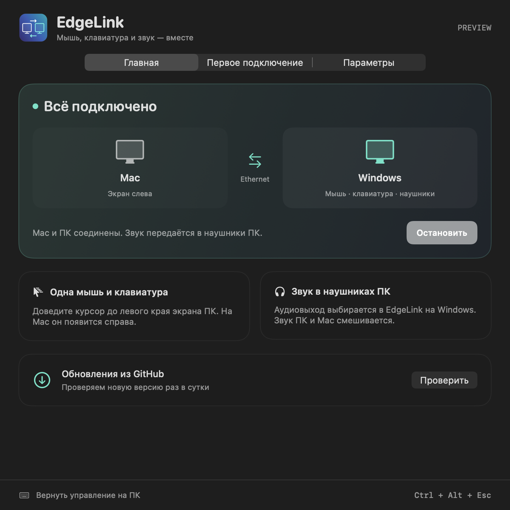
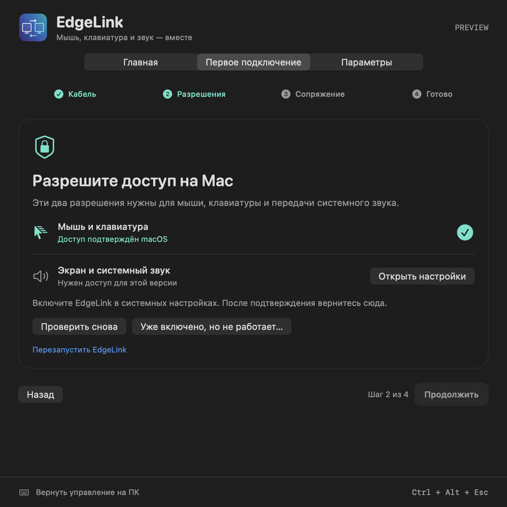

# EdgeLink

Use Windows keyboard and mouse on a Mac by crossing the screen edge; stream Mac system audio to Windows over a dedicated Ethernet cable. Mac is on the left by default.

Native SwiftUI menu bar app for Apple Silicon macOS 15+, and self-contained Windows x64 client. Automatic Ethernet discovery, secure one-time pairing, bounded audio buffer, GitHub Releases OTA updates, and platform icons.

[Download releases](https://github.com/b0rdik/EdgeLink/releases/latest) · [Настройка и ограничения на русском](README-RU.md) · [Release workflow](source/RELEASING.md)

Experimental release. Builds and cross-language protocol tests pass; physical Windows/Mac input, WASAPI and end-to-end latency still require hardware validation. macOS builds use Apple Development signing with a stable identity and are not notarized. Migration from ad-hoc builds needs a one-time permission repair in the setup wizard.

Version 0.3.0 adds a redesigned Windows dashboard, seven-size native ICO, a four-step setup wizard on both platforms, single-instance pairing import, and explicit recovery for stale macOS TCC grants.

Version 0.3.1 fixes the Windows dashboard layout: viewport-constrained card widths, measured text heights, responsive fields, vertical scrolling and screen-sized startup bounds. Native layout regression checks are available with `EdgeLink.exe --layout-checks`; they require Windows and have not been executed on the macOS build host.

Version 0.3.2 fixes a confirmed macOS audio capture crash caused by absolute indices on sliced `Data`. PCM packets now use the collection start index. Regression checks cover 10000 variable capture batches; Windows reports connection closure with actionable messages.
